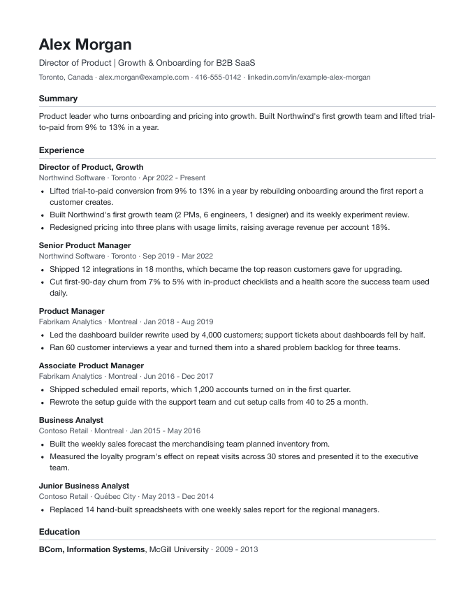

# Fenix

A job-hunt workspace you run on your own computer with [Claude Code](https://claude.com/claude-code). You keep one true record of your career; Fenix and Claude turn it into a tailored CV for each application, track the jobs you're considering, reuse the answers you've given, and check that no CV ever claims a number you can't back up.


## What it does

- **Home.** What needs you today (interviews this week, CVs ready to send, applications with no reply in 30 days), your setup steps until they're done, and everything Fenix can do with the sentence to tell Claude.
- **Career record.** Your positions, bullets, education, skills and courses, edited in the browser. Everything else is built from it.
- **CV versions.** One per application: a different headline and summary, the bullets that fit the job (reworded where it helps), the skills that matter. Your career record never changes. Each version prints to a PDF, and the PDF you send is kept with it. Pick a CV folder on the CVs page and each saved PDF is also copied there, ready to attach.
- **Designs.** Six built-in CV designs (Plain, Classic, Executive, Gutter, Sidebar, and One page, dense), each checked so application systems read it correctly and shown with your own career record on the Designs page, or your own: give Claude a screenshot of a CV you like and it builds a template from it.
- **Pipeline.** Jobs from LinkedIn, company job boards and job sites, checked against your pay floor and where you can work, with the posting's own words as evidence. Postings that close get flagged. Each column shows its first 8 jobs in the order you pick (best fit, newest or oldest), with the rest a click away.
- **Answers.** Every answer you give on an application form is saved and searchable, so the next form takes minutes.
- **Stories.** The context behind your results, with where each number comes from. A CV or LinkedIn draft can only use numbers that are in your career record or a story.
- **Interviews.** A brief before each round (the company, the people, what you told them before, the numbers to use) and a review after it from your Fellow or Wispr recording or a pasted transcript: each answer to keep or rework, and numbers that differ from your record. The lines that landed feed your CVs and LinkedIn.
- **LinkedIn.** Claude drafts your headline, About and role descriptions; you copy them in. A banner editor makes the profile background image.
- **Several people.** Each person has their own folder and pages. Nothing is shared between them.

<p align="center"></p>

## How it works

Fenix is a Next.js app that stores everything as plain YAML and Markdown files in `data/<person>/`, a separate git repository that only you hold. Claude Code does the work that needs judgment, through skills in `.claude/skills/`:

| Ask Claude to… | Skill |
| --- | --- |
| set you up from your CV, LinkedIn export or LinkedIn profile link | `fenix-onboard` |
| record the story behind a result | `fenix-stories` |
| brief you before an interview, or review one after it | `fenix-interview` |
| make a CV design from a screenshot | `fenix-template` |
| find jobs that fit | `fenix-hunt` |
| fill in an application (you click Submit) | `fenix-apply` |
| rewrite your LinkedIn profile | `fenix-linkedin` |

You don't need the skill names: say what you want in plain words. Every page that needs Claude shows a "What to tell Claude" sentence you can copy.

Claude never submits an application, sends a message, types a password or edits your LinkedIn profile. Browsing uses your own signed-in Chrome through the Claude in Chrome extension, and the skills check that the right person is signed in first.

Finding jobs, filling applications and reading LinkedIn need Claude Code with the Claude in Chrome extension. With another agent (Codex, ChatGPT), everything else works from the same files: paste job links and fill in forms yourself.

More detail: [docs/architecture.md](docs/architecture.md). Tailoring rules: [docs/cv-tailoring.md](docs/cv-tailoring.md).

## Set up

You need macOS or Linux, Node 22+, [pnpm](https://pnpm.io), git, `pdftotext` (poppler) and Claude Code.

```sh
git clone <this repo> fenix && cd fenix
pnpm get-started    # installs the libraries, makes data/ a git repo, adds a demo person, creates .env,
                    # and installs the Chromium that prints PDFs; safe to run again
pnpm dev            # http://localhost:3007
```

Open `http://localhost:3007/profiles` and look around the demo person, Alex Morgan. Then add yourself: your Home page lists each setup step (your CV or LinkedIn, your settings, a few career stories, your first job hunt) with what to tell Claude. Start Claude Code in this folder and say "set me up in Fenix", with your CV PDF or LinkedIn profile link at hand.

`ANTHROPIC_API_KEY` in `.env` is only needed for the "paste a job description" button on the CVs page; everything else runs inside Claude Code.

### Back up your data

`data/` holds your career history, applications and CVs. It lives only on your computer until you give it a **private** remote:

```sh
git -C data remote add origin <your private repo URL>
git -C data push -u origin HEAD
pnpm backup         # commit and push; run it from cron or launchd for a nightly backup
```

### A second person on the same computer

1. In the browser, open Profiles and add the person (or ask Claude to set them up). Their Home page shows what's left.
2. Give them their own Chrome profile (Chrome menu → Profiles → Add), sign in to their LinkedIn there, and install the Claude in Chrome extension in it. Each Chrome profile shows up as a separate browser for Claude.
3. When working for them, name them ("hunt jobs for Sam") or set `FENIX_PROFILE=<their folder>` before starting Claude Code.

## Checks

```sh
pnpm lint && pnpm exec tsc --noEmit
pnpm check:data         # every data file against its schema, every link between files, the number rule
pnpm check:templates    # built-in designs render and parse cleanly in three PDF text extractors; template sandbox guards hold
                        # (needs uv: brew install uv; the parse rules are checked on macOS, whose fonts the designs name)
pnpm check:isolation    # one person's data never shows on another's pages (needs pnpm dev running)
pnpm check:public       # no file in this repo names a person who has a profile in data/
```

## License

MIT. See [LICENSE](LICENSE).
