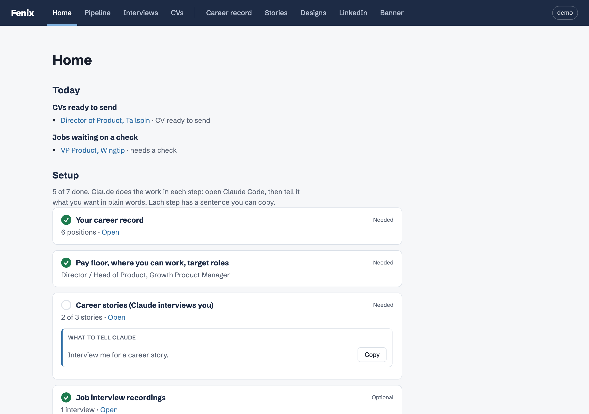
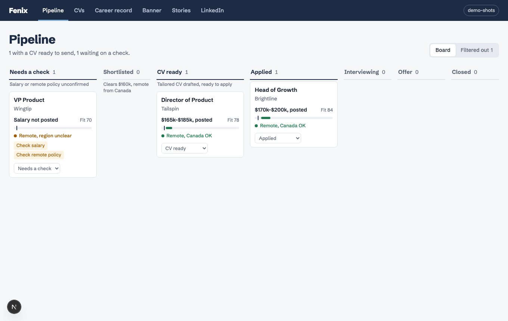
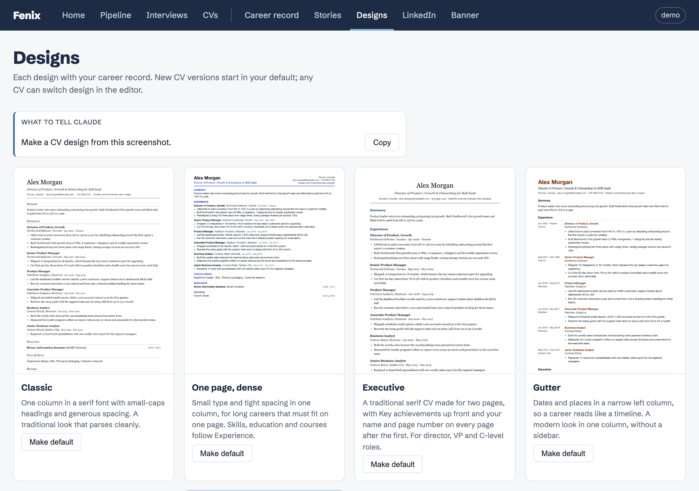

# Fenix

[](https://github.com/maurimtl/fenix/actions/workflows/checks.yml)

**A job-hunt workspace that runs on your own computer, with [Claude Code](https://claude.com/claude-code) doing the work.**

You keep one true record of your career. Fenix and Claude turn it into a tailored CV for each job, find postings that fit your pay floor and where you can work, fill in application forms from answers you've already given, brief you before interviews and review them after. Every number on every CV has to come from your record, so nothing you send overstates what you did.

Everything is plain files on your computer. There is no account, no cloud service and no subscription beyond the Claude plan you already use.



## Contents

- [What you get](#what-you-get)
- [Quick start](#quick-start-10-minutes)
- [Your first week](#your-first-week)
- [Day to day](#day-to-day)
- [What Claude will never do](#what-claude-will-never-do)
- [What you need](#what-you-need)
- [Your data](#your-data)
- [Several people on one computer](#several-people-on-one-computer)
- [Commands](#commands)
- [Troubleshooting](#troubleshooting)
- [How it's built](#how-its-built)

## What you get

| Page | What it does |
| --- | --- |
| **Home** | What needs you today: interviews this week, CVs ready to send, jobs waiting on a check, applications with no reply after 30 days. Your setup steps until they're done. Everything Fenix can do, each with the sentence to tell Claude. |
| **Pipeline** | Every job you're considering, from LinkedIn, company job boards and job sites. Each card shows the pay, whether you can work from where you are, and a fit score, with the posting's own words as evidence. Postings that close get flagged. |
| **CVs** | One CV version per application: its own headline and summary, the bullets that fit the job (reworded where it helps), the skills that matter. Your career record never changes. Each version prints to a PDF, and the PDF you sent is kept with it. |
| **Designs** | Six built-in CV designs, each previewed with your own career record and tested so applicant tracking systems read it correctly. Or give Claude a screenshot of a CV you like and it builds the design for you. |
| **Career record** | Your positions, bullets, education, skills and courses. Everything else is built from it. |
| **Stories** | The context behind your results and where each number comes from. Claude interviews you for them. |
| **Interviews** | A brief before each round, and a review after it from your recording or transcript: which answers to keep, which to rework, and any number that differs from your record. |
| **LinkedIn** | A rewrite of your headline, About and role descriptions, side by side with what's there now, each with a Copy button. A banner editor for the background image. |



## Quick start (10 minutes)

You need a Mac (Linux works too, see [What you need](#what-you-need)), [Node 22+](https://nodejs.org), [pnpm](https://pnpm.io), git, `pdftotext` and Claude Code. On a Mac:

```sh
brew install node pnpm poppler        # poppler provides pdftotext
```

Then:

```sh
git clone https://github.com/maurimtl/fenix.git
cd fenix
pnpm get-started    # installs everything, adds a demo person, makes data/ its own git repo; safe to run again
pnpm dev            # starts Fenix at http://localhost:3007
```

Open http://localhost:3007. You'll land on the demo person, Alex Morgan, whose career, jobs, CVs, stories and an interview are all made up. Click around to see how it fits together.

Then, in a second terminal, start Claude Code in the same folder and say:

> Set me up in Fenix. Here's my CV (I'll attach the PDF) or my LinkedIn profile link.

From there, your own Home page walks you through the rest.

## Your first week

Each step is something you **say to Claude Code** in plain words. You don't need to know any commands; every page that needs Claude shows the sentence, with a Copy button.

### 1. Your career record (about 15 minutes)

> Set me up in Fenix. Here's my CV.

Attach a CV PDF, a LinkedIn data export or your LinkedIn profile link. Claude reads it, creates your profile and writes your career record: every position, bullet, school, skill and course. It never invents experience or numbers; anything it can't read, it asks about. Check the result on the **Career record** page and fix anything there.

### 2. Your settings (5 minutes)

> Ask me the Fenix settings questions: pay floor, where I can work and the roles I want.

Your pay floor, the countries and time zones you can work from, and the titles you're after. The job hunt checks every posting against these.

### 3. Career stories (15 minutes each, do three)

> Interview me for a career story.

Claude asks about one result at a time: the situation, what you did, what changed, and where each number comes from. Stories are what make tailored CVs and interview answers strong, and they're the only place, besides your career record, that a CV may take a number from.

### 4. A CV design (optional)

Open **Designs** and pick one with **Make default**, or:

> Make a CV design from this screenshot.

Claude builds the design from your image, renders it with your own data and compares the two side by side, for up to five rounds, then takes your tweaks.



### 5. Your first job hunt

> Find me jobs.

Claude browses LinkedIn in your own signed-in Chrome, plus job sites and the career pages of companies you follow. It checks each posting against your settings and saves every one to your **Pipeline**, with the posting's words on pay and location as evidence. For strong matches it drafts a tailored CV. It never applies or messages anyone.

### 6. A CV for a job

> Make a CV for this job: https://…

Claude reads the posting and makes a CV version: a headline and summary aimed at the role, the bullets that matter most, reworded in the job's language where that's still true. Open it on the **CVs** page, edit anything, and download the PDF.

### 7. Applying

> Help me apply to Northwind, Director of Product.

Claude opens the application form in your Chrome and reads every question first. It proposes an answer for each one, reusing answers you've given before, and shows you the list. After you approve, it fills the form and attaches the CV. **You click Submit.** Your answers are saved, so the next form goes faster.

### 8. Interviews

> Brief me for my next interview at Northwind.

> Review my last job interview. The recording is in Fellow, or I'll paste the transcript.

Before a round: who you're meeting, what you told them last time, the stories and numbers to use. After it: each answer to keep or rework, and any number you said that differs from your record. Your best answers are kept for next time.

### 9. LinkedIn (optional)

> Read my LinkedIn profile and draft a rewrite.

Claude reads your profile and drafts a new headline, About and role descriptions from your career record and stories. You paste them into LinkedIn yourself.

## Day to day

Open **Home** (http://localhost:3007). It lists what needs you today. A typical session:

1. "Find me jobs." Claude adds new postings to your Pipeline.
2. Look through **Needs a check** and **Shortlisted**; move what you like along, close what you don't.
3. "Make a CV for this job: …" for the ones worth applying to.
4. "Help me apply to …", review the answers, click Submit.
5. After an interview, "Review my last job interview."

## What Claude will never do

- Submit an application, send a message or email, or accept an invitation. It stops before the final button.
- Type a password or sign in for you.
- Edit your LinkedIn profile. It drafts; you paste.
- Put a number on a CV or LinkedIn draft that isn't in your career record or a story.
- Use one person's data while working for another. Before any LinkedIn page or application form, it checks that the person signed in to Chrome is the person it's working for.

## What you need

| | |
| --- | --- |
| **Claude Code** | Required. Does all the work that needs judgment, through the skills in `.claude/skills/`. |
| **Claude in Chrome** (the Claude browser extension) | Required for finding jobs, applying and reading LinkedIn. Claude browses in your own signed-in Chrome, so it sees what you see and never needs your passwords. |
| **Node 22+, pnpm, git, `pdftotext`** | Required. `pdftotext` comes with poppler (`brew install poppler` on a Mac, `apt install poppler-utils` on Debian or Ubuntu). |
| **Exa and Tavily** | Optional. Search engines for agents that find postings plain web search misses. Add them to Claude Code with `claude mcp add`. |
| **Fellow or Wispr Flow** | Optional. If you record interviews with one of them and connect it to Claude, interview reviews read the recording directly. Otherwise, paste a transcript. |
| **`ANTHROPIC_API_KEY`** | Optional. Only for the "paste a job description" button on the CVs page, which calls the Claude API directly and is billed to your key. Everything else runs inside Claude Code. |

**Other AI tools** (Codex, ChatGPT): everything except finding jobs, applying and reading LinkedIn works from the same files. Paste job links and fill in forms yourself.

**Linux** runs Fenix. The design checks are tuned to the fonts macOS ships, so a CV may lay out slightly differently.

## Your data

Everything about you lives in `data/<your-name>/` as YAML and Markdown files you can open in any editor:

```
data/alex-morgan/
  profile.yaml        name, contact details, settings
  career.yaml         your career record
  cvs/                one file per CV version, plus the PDFs you sent
  jobs/               one file per job in your pipeline
  stories/            your career stories
  interviews/         briefs, reviews and your best answers
  memory/             what Claude remembers about you between sessions
  templates/          your own CV designs
```

`data/` is its own git repository, separate from Fenix's code and never pushed with it. Every save is a commit, so you can see and undo any change.

### Back it up

Until you set up a backup, your data exists only on this computer. Create a **private** repository (for example on GitHub) and run:

```sh
git -C data remote add origin <your private repo URL>
git -C data push -u origin HEAD
```

After that, `pnpm backup` commits and pushes. Run it nightly from cron or launchd. To restore on a new computer: clone Fenix, then `git clone <your private repo URL> data`.

### A folder of ready-to-attach CVs

On the **CVs** page, pick a folder (for example `~/Documents/CVs`). Every CV PDF you save is also copied there with a readable name, ready to attach to an email or a form. **Copy all** fills it from your current CV versions.

## Several people on one computer

Each person has their own folder, pages and settings; nothing is shared between them.

1. Open **Profiles** (the name in the top-right corner) and add the person, or ask Claude: "Set up Fenix for Sam."
2. Give them their own Chrome profile (Chrome menu → Profiles → Add), sign in to their LinkedIn there and install Claude in Chrome in it. Each Chrome profile shows up as a separate browser for Claude.
3. When working for them, name them ("Find jobs for Sam") or start Claude Code with `FENIX_PROFILE=<their folder> claude`.

## Commands

You rarely need these; Claude runs them for you.

```sh
pnpm dev                          # start Fenix at http://localhost:3007
pnpm get-started                  # first-time setup; safe to run again
pnpm backup                       # commit data/ and push it to your private remote
pnpm fenix create-profile "Name"  # add a person
pnpm fenix sync-cvs <person>      # fill the CV folder from the current CV versions
pnpm check:data                   # every data file against its schema, plus the number rule
pnpm check:claims                 # list numbers on CVs that aren't in the career record or a story
pnpm check:closed <person>        # ask Ashby, Greenhouse and Lever whether open jobs are still posted
```

## Troubleshooting

- **Claude says the browser isn't connected.** Open Chrome, check that the Claude extension is installed and signed in, then try again.
- **A design preview or PDF says it couldn't be rendered.** Fenix renders PDFs by calling itself at `http://localhost:3007`. If you run it on another port, set `APP_URL=http://localhost:<port>` in `.env`.
- **PDFs fail with a Chromium error.** Run `pnpm get-started` again; it installs the Chromium that prints PDFs if it is missing.
- **A page shows "Can't read the job files".** A data file was edited by hand and no longer parses. `pnpm check:data` names the file and the line.
- **Claude works on the wrong person.** Name the person in your request, or set `FENIX_PROFILE`.

## How it's built

Next.js and TypeScript, with plain files instead of a database. Every write goes through `lib/store/` (schema checks, atomic writes, a lock per person, a git commit per save). CV designs are Liquid templates rendered in a sandbox and printed by headless Chromium. The skills in `.claude/skills/` hold the instructions Claude follows for each job.

- [docs/architecture.md](docs/architecture.md): files, people, CV versions, designs, jobs and the number rule
- [docs/cv-tailoring.md](docs/cv-tailoring.md): how a CV is tailored to a job
- [CLAUDE.md](CLAUDE.md): the rules Claude follows when working on Fenix itself

Changes are made spec first: `/fenix-spec`, then `/fenix-plan`, then `/fenix-build`, with each topic's plan in `docs/plans/`. Before sending a change, run:

```sh
pnpm lint && pnpm exec tsc --noEmit
pnpm check:data && pnpm check:templates && pnpm check:public
pnpm check:isolation    # needs pnpm dev running
```

## License

MIT. See [LICENSE](LICENSE).

The two debugging skills in `.claude/skills/obra-*` come from [obra/superpowers](https://github.com/obra/superpowers) by Jesse Vincent, MIT; each keeps its licence beside it.

Found a security problem? See [SECURITY.md](SECURITY.md).
